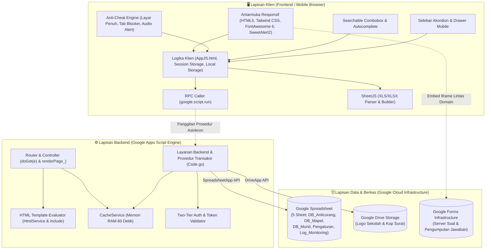
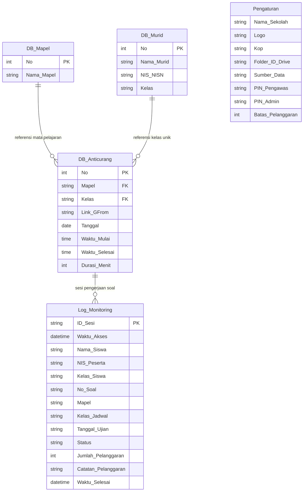
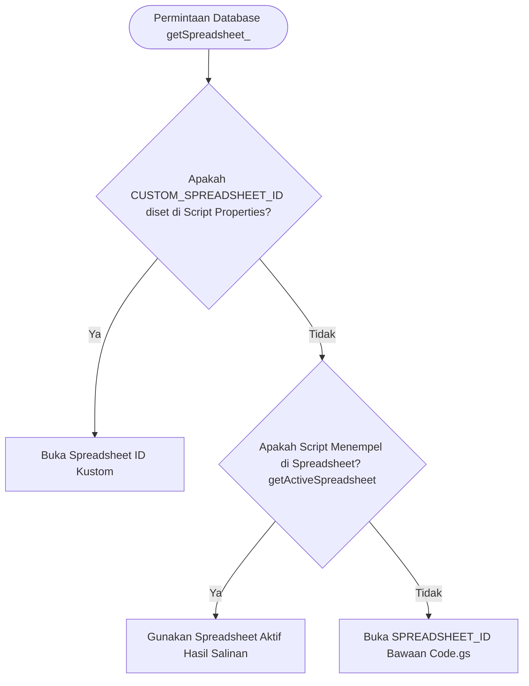

# ARSITEKTUR & TEKNIK PEMBUATAN WEB APLIKASI UJIAN ANTICURANG

Dokumentasi Arsitektur, Desain Rekayasa Perangkat Lunak, dan Panduan Teknis Pembuatan Aplikasi Portal Ujian Google Form Mode Anticurang & Dashboard Monitoring Real-Time Berbasis Google Apps Script, Google Sheets Database, dan Google Drive Storage.

---

## 📌 1. Klasifikasi & Pilar Teknik Arsitektur

Aplikasi web ini dibangun dengan menerapkan 12 pilar rekayasa perangkat lunak web modern:

1. **Google Apps Script HTML Service — Server-Side Template Inclusion (Scriptlet Pattern)**
2. **Multi-Page Serverless Web Application (MPA) Berbasis Query Parameter Routing**
3. **BaaS (Backend-as-a-Service) & Spreadsheet-Driven Database Architecture (5 Tab Sheet)**
4. **Asynchronous Remote Procedure Call (RPC) Client-Server Communication via `google.script.run`**
5. **Anti-Cheat Enforcement Engine (Fullscreen Lock, Focus/Blur Detection, DevTools/Shortcut Block, Watermark, & Web Audio Alarm)**
6. **Graceful Time-Up Protection (Penanganan Waktu Habis Tanpa Menutup Google Form & Memandu Siswa Klik Kirim)**
7. **High-Performance Serverless CacheService (60 Detik TTL dengan Instant Cache Busting)**
8. **Dynamic Database Connection Hierarchy & Portability Engine (Pindah Database Tanpa Edit Kode)**
9. **Two-Tier Role-Based Access Control (RBAC: Publik/Siswa, Pengawas, Administrator)**
10. **Searchable Combobox & Autocomplete Engine (Filter Kelas, Pemilihan Siswa & Auto-Fill NIS)**
11. **SheetJS Fast Excel Engine & Dynamic Adaptive Print / PDF Engine (Smart Kop Divider & TTD Dinamis)**
12. **Mobile-First Responsive Layout (`100dvh`) dengan Off-Canvas Drawer & Modern Action Icon Buttons**

---

## 🏗️ 2. Gambaran Umum Arsitektur Sistem

Aplikasi dibangun 100% tanpa server fisik (VPS), tanpa hosting berbayar (cPanel/Cloud Hosting), dan tanpa database engine SQL konvensional (MySQL/PostgreSQL). Seluruh sistem berjalan di atas infrastruktur **Google Cloud Platform (GCP)** secara serverless:



---

## 🧩 3. Bedah Teknik: Server-Side Template Inclusion (Scriptlet Pattern)

Setiap file tampilan web (seperti `Portal.html`, `Monitoring.html`, `Laporan.html`, `KelolaSoal.html`, `DataMapel.html`, `DataMurid.html`, `Pengaturan.html`) memiliki kerangka dokumen lengkap (`<!DOCTYPE html>`, `<html>`, `<head>`, `<body>`).

Komponen bersama (*shared components*) tidak diduplikasi, melainkan diinjeksi oleh server menggunakan **Scriptlet Inclusion** bawaan Google Apps Script:

```html
<!DOCTYPE html>
<html lang="id">
<head>
  <meta charset="UTF-8">
  <title>Kelola Link Soal - Ujian Anticurang</title>
  <?!= include('StyleCSS'); ?>   <!-- Injeksi Stylesheet Global & Tailwind/FontAwesome -->
</head>
<body class="bg-slate-50 text-slate-800 flex h-screen overflow-hidden">
  <?!= include('Sidebar'); ?>    <!-- Injeksi Navigasi Sidebar Akordion & Drawer -->

  <div class="flex-1 flex flex-col h-screen overflow-hidden w-full">
    <?!= include('Header', { pageTitle: 'Kelola Link Soal' }); ?> <!-- Injeksi Navbar Atas -->
    
    <main class="flex-1 overflow-y-auto p-4 md:p-6 pb-24">
      <!-- Konten Khusus Halaman -->
    </main>
  </div>

  <?!= include('AppJS'); ?>      <!-- Injeksi Logika Klien Global & RPC Wrapper -->
</body>
</html>
```

### Jenis Scriptlet Google Apps Script yang Digunakan

- `<?!= ... ?>` (**Force-Printing Scriptlet / Unescaped**): Mencetak blok kode HTML/CSS/JS dari file partial tanpa sanitasi encoding, sehingga browser merender komponen secara utuh.
- `<?= ... ?>` (**Printing Scriptlet / Escaped**): Mencetak data dengan sanitasi HTML (mencegah XSS).
- `<? ... ?>` (**Code Scriptlet**): Menjalankan logika kontrol server (`if/else`, perulangan) sebelum dokumen dikirim ke klien.

### Mesin Kompilator di Code.gs

```javascript
function include(filename, data) {
  try {
    var t = HtmlService.createTemplateFromFile(filename);
    t.currentPage = _activePage;
    t.params = _activeParams;
    t.appUrl = getAppUrl();
    if (data && typeof data === 'object') {
      for (var k in data) {
        if (data.hasOwnProperty(k)) t[k] = data[k];
      }
    }
    return t.evaluate().getContent();
  } catch (err) {
    return '<!-- Gagal memuat komponen "' + filename + '": ' + err.message + ' -->';
  }
}
```

---

## 🚦 4. Routing Multi-Page & Penanganan Iframe Sandbox

Google Apps Script hanya memiliki **satu URL eksekusi induk** (`/exec`). Untuk menyajikan banyak halaman, digunakan teknik **Query Parameter Routing** (`?page=...`):

### Peta Rute di Code.gs

```javascript
const ROUTE_MAP = {
  'portal': 'Portal',
  'jadwal': 'Portal',
  'admin': 'Monitoring',
  'pengawas': 'Monitoring',
  'monitoring': 'Monitoring',
  'laporan': 'Laporan',
  'kelola-soal': 'KelolaSoal',
  'data-master': 'DataMapel',
  'data-mapel': 'DataMapel',
  'data-murid': 'DataMurid',
  'murid': 'DataMurid',
  'pengaturan': 'Pengaturan'
};
```

### Solusi Blank Putih & Navigasi Induk (`window.top.location.href`)

Aplikasi Web Apps Script berjalan di dalam **iframe sandbox** (`script.googleusercontent.com`). Jika berpindah halaman hanya menggunakan `window.location.href`, browser akan mengarahkan iframe ke URL domain terisolasi yang menyebabkan **blank putih** dan memutus tautan induk.

Solusi yang diterapkan pada `AppJS.html`:

```javascript
function navigateTo(page, params) {
  sessionStorage.setItem('anticurang_active_page', page);
  localStorage.setItem('anticurang_active_page', page);

  let baseUrl = getAppUrl();
  let url = baseUrl + '?page=' + encodeURIComponent(page);
  if (params && typeof params === 'object') {
    for (let k in params) {
      if (params.hasOwnProperty(k)) {
        url += '&' + encodeURIComponent(k) + '=' + encodeURIComponent(params[k]);
      }
    }
  }

  try {
    if (window.top && window.top !== window) {
      window.top.location.href = url;
      return;
    }
  } catch (e) {}

  window.location.href = url;
}
```

**Manfaat Utama**:

1. Menghindari blank putih akibat pembatasan sandbox iframe Google.
2. Memperbarui query parameter di address bar browser secara nyata.
3. Saat pengguna me-refresh browser (F5), aplikasi **tetap berada di halaman yang sedang aktif** dan tidak terlempar kembali ke portal utama.

---

## 🛡️ 5. Arsitektur Keamanan Mode Anticurang (Anti-Cheat Engine)

Fitur anticurang beroperasi secara berlapis pada sisi klien (*frontend client-side enforcement*) dan dicatat secara realtime ke server:

### A. Kunci Layar Penuh (*Fullscreen Lock*)

Memanfaatkan W3C Fullscreen API (`requestFullscreen` & `webkitRequestFullscreen`):

- Begitu siswa menekan tombol *"Buka Soal Anticurang"*, antarmuka ujian memasuki layar penuh.
- Jika siswa menekan tombol Escape atau berusaha keluar dari layar penuh, event listener mendeteksi keluarnya mode fullscreen dan segera memunculkan overlay peringatan.

### B. Deteksi Pindah Tab & Pengaburan Layar (*Visibility & Blur Events*)

- `document.addEventListener('visibilitychange')`: Mendeteksi saat tab ujian disembunyikan atau siswa membuka tab baru.
- `window.addEventListener('blur')`: Mendeteksi saat jendela ujian kehilangan fokus (misal siswa membuka aplikasi WhatsApp, browser lain, kalkulator, atau split-screen).
- Terdapat toleransi cerdas (`ignoreBlurUntil`) untuk mencegah *false alarm* saat siswa berinteraksi dengan dialog sistem seperti pengunggah berkas di dalam Google Form.

### C. Pemblokiran Pintasan Keyboard & DevTools

Event listener menangkap dan membatalkan pintasan berbahaya pada fase tangkap (`useCapture: true`):

- **F12**, **Ctrl+Shift+I**, **Ctrl+Shift+J**, **Ctrl+Shift+C**: Pemblokiran akses Developer Tools inspect element.
- **Ctrl+C**, **Ctrl+V**, **Ctrl+X**: Pemblokiran salin-tempel jawaban.
- **Ctrl+U**: Pemblokiran lihat sumber kode halaman.
- **Ctrl+S, Ctrl+P, Ctrl+R, Ctrl+W, Ctrl+T, Ctrl+N**: Pemblokiran simpan, cetak, refresh, tutup tab, dan buka tab/jendela baru.
- **Klik Kanan (`contextmenu`)**: Dinonaktifkan dengan notifikasi toast peringatan.

### D. Audio Alarm (*Web Audio API*)

Menggunakan sintesis frekuensi bawaan peramban tanpa membutuhkan berkas audio eksternal (`.mp3`/`.wav`):

```javascript
function playAlertBeep() {
  const AudioCtx = window.AudioContext || window.webkitAudioContext;
  if (!AudioCtx) return;
  const ctx = new AudioCtx();
  const osc = ctx.createOscillator();
  const gain = ctx.createGain();
  osc.type = 'triangle';
  osc.frequency.value = 660; // Frekuensi nada tinggi peringatan
  gain.gain.value = 0.08;
  osc.connect(gain);
  gain.connect(ctx.destination);
  osc.start();
  setTimeout(function () { osc.stop(); ctx.close(); }, 220);
}
```

### E. Batas Maksimal Pelanggaran & Kunci PIN Pengawas

- Pelanggaran dihitung secara bertahap (1x, 2x, 3x).
- Jika jumlah pelanggaran mencapai batas `Batas Pelanggaran` (tersimpan di sel `H2` Sheet Pengaturan), lembar soal Google Form **terkunci total** di balik overlay gelap.
- Layar hanya dapat dibuka kembali jika Pengawas Ruang memasukkan **PIN Pengawas** (`654321`) yang diverifikasi langsung ke server.

### F. Dinamik Watermark Anti-Foto

Di atas lembar soal Google Form diinjeksi lapisan watermark transparan semi-terlihat yang memuat teks:
`NAMA LENGKAP SISWA • NAMA MATA PELAJARAN • ANTICURANG`
Hal ini mencegah kecurangan di mana siswa memotret layar ponsel dan membagikannya ke luar.

---

## ⏰ 6. Graceful Time-Up Protection (Penanganan Waktu Habis Google Form)

### Batasan Keamanan Browser (Same-Origin Policy)

Google Form berada di dalam `<iframe>` bersumber dari `docs.google.com`, sedangkan web aplikasi berada di `script.google.com`. Browser dunia menerapkan aturan isolasi lintas domain (**Same-Origin Policy**) yang melarang dokumen induk mengeklik elemen di dalam iframe Google Form secara otomatis.

### Solusi Perlindungan Jawaban Murid

Alih-alih langsung menutup paksa halaman dan menghapus iframe saat waktu habis (`00:00:00`), sistem menerapkan alur penyelamatan jawaban:

1. Formulir Google Form **tetap dibiarkan aktif di layar**.
2. Alarm peringatan berbunyi dan muncul modal dialog mencolok:
   > *"⏰ **WAKTU UJIAN TELAH HABIS!** Segera gulir ke bagian paling bawah Google Form dan klik tombol **Kirim / Submit** sekarang juga agar jawaban tersimpan ke sistem guru."*
3. Di bilah atas runner muncul spanduk merah berkedip sebagai pengingat darurat.
4. Siswa memiliki kesempatan penuh untuk menekan tombol **"Kirim"** pada Google Form.
5. Setelah formulir terkirim, siswa menekan tombol **"Saya Sudah Kirim & Selesai"**. Sesi ditutup secara tertib dan tercatat di Dashboard Monitoring sebagai status `"Selesai (Waktu Habis)"`.

### Pengingat Sisa Waktu 2 Menit & 1 Menit (Bebas Pelanggaran)

Untuk memberikan kesadaran waktu kepada peserta didik tanpa menimbulkan kepanikan:

1. **Notifikasi Sisa Waktu 2 Menit**:
   - Terpicu saat timer pengerjaan tersisa $\le 120$ detik.
   - Memunculkan popup amber dengan ikon jam pasir dan nada chime lembut.
   - Mengingatkan siswa untuk segera meninjau kembali seluruh butir soal yang belum terjawab.

2. **Notifikasi Sisa Waktu 1 Menit**:
   - Terpicu saat timer pengerjaan tersisa $\le 60$ detik.
   - Memunculkan popup merah berkedip dengan nada peringatan.
   - Menginstruksikan siswa agar bersiap menggulir ke bagian bawah Google Form untuk melakukan submit.

3. **Mekanisme Pengecualian Pelanggaran (Zero-Violation Exemption)**:
   - Saat modal pengingat muncul, status `examState.isReminderActive` aktif dan `examState.ignoreBlurUntil` diperpanjang otomatis.
   - Seluruh pendengar peristiwa keamanan (`blur`, `visibilitychange`, `fullscreenchange`, dan `heartbeat`) di-bypass sehingga pergerakan fokus atau klik tombol murid dijamin **bebas 100% dari hitungan pelanggaran**.
   - Setelah notifikasi ditutup (baik melalui tombol konfirmasi maupun *auto-dismiss* 8 detik), fokus dikembalikan ke lembar Google Form disertai buffer toleransi 4 detik.

---

## 🗄️ 7. Arsitektur Database Google Spreadsheet (5 Tab Sheet)

Database dirancang dengan prinsip normalisasi data ringan:



1. **`DB_Anticurang`** (Jadwal & Link Soal): Menyimpan nomor soal, mapel, kelas, link Google Form responden, tanggal, rentang jam buka portal, dan durasi pengerjaan.
2. **`DB_Mapel`** (Master Mata Pelajaran): Menyimpan daftar mata pelajaran resmi sekolah untuk dropdown kelola soal.
3. **`DB_Murid`** (Master Data Siswa): Menyimpan Nomor, Nama Lengkap Murid, NIS/NISN, dan Kelas. Data kelas unik pada sheet ini otomatis dijadikan pilihan kelas saat pembuatan soal.
4. **`Pengaturan`** (Identitas Sistem & Keamanan): Menyimpan nama instansi, logo, kop surat, ID folder drive, PIN Pengawas (`F2`), PIN Admin (`G2`), dan Batas Maksimal Pelanggaran (`H2`).
5. **`Log_Monitoring`** (Riwayat Sesi & Pelanggaran): Menyimpan log audit forensik pengerjaan ujian tiap siswa secara *real-time*.

---

## 🚀 8. Teknik Optimasi Kecepatan & Skala Massal (*High-Performance CacheService*)

Untuk mendukung **100 hingga 500+ siswa ujian serentak**, sistem menerapkan arsitektur *Caching Layer*:

1. **Serverless Script Cache (TTL 60 Detik)**:
   - Data jadwal ujian, branding sekolah, dan daftar murid di-cache di RAM server Google Apps Script (`CacheService.getScriptCache()`).
   - Waktu respons pembacaan jadwal turun dari **~1.200 ms menjadi < 30 ms** saat ratusan siswa membuka portal ujian bersamaan.
2. **Pembersihan Cache Otomatis (*Instant Cache Busting*)**:
   - Fungsi `clearPortalCache_()` dipanggil setiap kali Admin melakukan operasi mutasi (tambah soal, edit soal, hapus soal, tambah murid, impor excel, ubah pengaturan). Pembaruan langsung terlihat seketika tanpa perlu menunggu masa kadaluarsa 60 detik.
3. **Eliminasi Operasi Header Ganda**:
   - Pengecekan struktur tabel hanya dijalankan saat mutasi atau inisialisasi awal, menghilangkan beban baca-tulis header pada setiap *read request*.

---

## 🔄 9. Portabilitas Database Dinamis (Pindah Database Tanpa Ubah Kode)

Aplikasi dirancang agar pengguna non-teknis dapat memindahkan database ke Spreadsheet baru tanpa menyentuh kode kodingan:



- **Fitur Ganti Spreadsheet**: Cukup tempel link/ID Google Sheet baru di menu **Pengaturan Sistem** $\rightarrow$ klik **Simpan Pengaturan**.
- **Tombol Siapkan Struktur Database**: Mengecek dan membuat otomatis ke-5 sheet database (`DB_Anticurang`, `DB_Mapel`, `DB_Murid`, `Pengaturan`, `Log_Monitoring`) beserta header kolom standarnya pada Spreadsheet baru.

---

## 🔍 10. Searchable Combobox & Autocomplete Cerdas

Untuk mempermudah input di layar ponsel maupun desktop:

1. **Filter Kelas Portal Publik**:
   - Menggunakan komponen **Custom Searchable Combobox**. Pengguna dapat mengetik kelas (misal: `"DKV"`) untuk menyaring soal secara langsung, atau mengeklik ikon panah untuk memilih dari daftar dropdown.
2. **Modal Masuk Ujian Siswa**:
   - Kolom **Kelas** terkunci otomatis sesuai jadwal soal yang dipilih.
   - Kolom **Nama Lengkap Siswa** dapat dipilih melalui daftar atau diketik nama panggilannya.
   - Kolom **NIS / No. Peserta** otomatis terisi (*auto-fill*) mengikuti data siswa yang dipilih dari sheet `DB_Murid`.
3. **Kelola Link Soal**:
   - Input Kelas dan Mata Pelajaran dilengkapi searchable datalist autocomplete untuk mempercepat pemilihan.

---

## 🖨️ 11. Dynamic Adaptive Print & PDF Engine (`Laporan.html`)

Fitur cetak berita acara dan laporan monitoring dinas dilengkapi:

1. **Smart Kop Divider**: Otomatis mendeteksi apakah kop berupa gambar Google Drive (LH3 Thumbnail Engine) atau teks instansi dengan garis ganda dinas.
2. **TTD Pengawas & NIP Dinamis Tanpa Garis Potong**:
   - Pengawas dapat mengetik Nama Pengawas dan NIP pada bilah toolbar atas.
   - Nama dan NIP otomatis mengisi blok tanda tangan di kanan bawah lembar laporan cetak tanpa garis horizontal (`border-t`) yang memotong di atas nama.
   - Data TTD disimpan di `localStorage` sehingga tidak perlu diketik ulang saat membuka laporan di lain waktu.
3. **Print-Ready Clean Mode**: Bilah kontrol toolbar otomatis disembunyikan saat dicetak ke printer fisik atau disimpan sebagai PDF.

---

## 📊 12. SheetJS Fast Excel Engine & Ikon Aksi Modern

1. **Pemrosesan Spreadsheet Sisi Klien**: Menggunakan pustaka SheetJS (`xlsx.full.min.js`) untuk membaca dan menyusun berkas Excel (`.xls` BIFF8 dan `.xlsx`) langsung di peramban tanpa membebani server backend.
2. **Ikon Tombol Aksi Modern**: Seluruh tabel menggunakan tombol ikon modern dengan tooltip informatif:
   - `<i class="fa-solid fa-pen-to-square"></i>` (Edit Data - Biru)
   - `<i class="fa-solid fa-trash-can"></i>` (Hapus Data - Merah)
   - `<i class="fa-solid fa-arrow-up-right-from-square"></i>` (Uji Form)
   - `<i class="fa-regular fa-copy"></i>` (Salin Tautan)
   - `<i class="fa-solid fa-file-lines"></i>` (Detail Log Forensik Pelanggaran)
